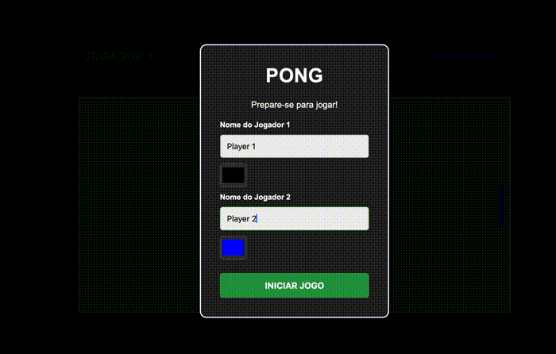

<div align="center">

# 🏓 Pong — Speedrun Edition (5 Points Challenge)


<p align="center">
  <a href="#-português">🇧🇷 Português</a> •
  <a href="#-english">🇺🇸 English</a>
</p>



</div>

---

## 🇧🇷 Português

### 💻 Sobre o Projeto
Uma releitura competitiva do clássico **Pong**, desenvolvida com **HTML5, CSS3, JavaScript puro (Vanilla JS)** e um backend leve em **PHP**. 

Diferente do Pong tradicional infinito, esta versão funciona no formato **Speedrun**: vence quem marcar **5 pontos primeiro**, e um cronômetro de alta precisão registra o tempo exato da partida. Ao final do jogo, o resultado é enviado de forma assíncrona (`fetch` API) para o servidor PHP, que armazena e ordena o **Top 10 das vitórias mais rápidas** em ordem crescente de tempo.

### ✨ Funcionalidades
* **Menu Inicial Personalizável:** Inserção do nome dos dois jogadores e escolha de cores personalizadas (`<input type="color">`) para as raquetes e placar.
* **Física Dinâmica a 60 FPS:** Movimentação fluida renderizada com `requestAnimationFrame` e aceleração progressiva da bola (+12% de velocidade a cada rebatida).
* **Cronômetro em Tempo Real:** Medição precisa com `performance.now()` durante toda a partida.
* **Sistema de Ranking (Leaderboard):** Backend em PHP com persistência em JSON, sanitização contra XSS (`strip_tags` / `htmlspecialchars`) e ordenação automática pelo menor tempo (`usort` com *Spaceship Operator* `<=>`).
* **Fluxo de Partida Completo:** Telas modais para início de jogo, exibição de vencedor, revanche rápida com os mesmos jogadores ou troca de nomes.

### 🎮 Controles

| Jogador | Movimento para Cima | Movimento para Baixo |
| :--- | :---: | :---: |
| **Jogador 1 (Esquerda)** | `W` | `S` |
| **Jogador 2 (Direita)** | `↑` (Seta para Cima) | `↓` (Seta para Baixo) |

### 📂 Estrutura de Arquivos
```text
Pong/
├── assets/
│   └── gameplay.gif    # Demonstração animada do projeto
├── index.html          # Estrutura do campo, placar e modais (inicial e ranking)
├── style.css           # Estilização visual, layout flexbox e animações
├── script.js           # Motor do jogo, colisões, cronômetro e integração Fetch API
├── ranking.php         # API em PHP para leitura, ordenação e gravação dos recordes
├── ranking_dados.json  # Arquivo gerado automaticamente pelo PHP com o histórico
└── README.md           # Documentação bilíngue do projeto
```

### 🚀 Como Executar Localmente

1. **Clone o repositório:**
   ```bash
   git clone https://github.com/thalesboss/Pong.git
   cd Pong
   ```

2. **Inicie o servidor embutido do PHP:**
   > No macOS, caso ainda não tenha o PHP instalado via Homebrew, execute `brew install php`.
   ```bash
   php -S localhost:8000
   ```

3. **Acesse no navegador:**
   Abra [http://localhost:8000](http://localhost:8000) e comece a jogar!

---

## 🇺🇸 English

### 💻 About the Project
A competitive take on the classic **Pong** arcade game, built from scratch using **HTML5, CSS3, Vanilla JavaScript**, and a lightweight **PHP** backend.

Instead of an endless match, this edition introduces a **Speedrun mode**: the first player to score **5 points** wins, while a high-precision timer tracks the match duration. Once the match ends, the result is sent asynchronously via the `fetch` API to a PHP script that stores and sorts the **Top 10 fastest victories** in ascending order.

### ✨ Features
* **Customizable Start Menu:** Players can enter their names and pick custom colors (`<input type="color">`) for their paddles and scoreboard HUD.
* **Dynamic 60 FPS Physics:** Smooth game loop powered by `requestAnimationFrame` with progressive ball acceleration (+12% speed per paddle hit).
* **Real-Time Stopwatch:** High-resolution time tracking using `performance.now()`.
* **Speedrun Leaderboard:** PHP backend with JSON persistence, XSS sanitization (`strip_tags` / `htmlspecialchars`), and automatic ascending time sorting (`usort` using the `<=>` Spaceship Operator).
* **Seamless Match Flow:** Interactive modals for player setup, winner announcement, instant rematch, or switching players.

### 🎮 Controls

| Player | Move Up | Move Down |
| :--- | :---: | :---: |
| **Player 1 (Left)** | `W` | `S` |
| **Player 2 (Right)** | `↑` (Up Arrow) | `↓` (Down Arrow) |

### 📂 Project Structure
```text
Pong/
├── assets/
│   └── gameplay.gif    # Animated gameplay preview
├── index.html          # Game board, HUD, and modal overlays (start & leaderboard)
├── style.css           # Visual styling, Flexbox layout, and table formatting
├── script.js           # Game loop, collision physics, timer, and Fetch API logic
├── ranking.php         # PHP endpoint to process, sort, and store match records
├── ranking_dados.json  # Auto-generated JSON file storing the leaderboard data
└── README.md           # Bilingual project documentation
```

### 🚀 How to Run Locally

1. **Clone the repository:**
   ```bash
   git clone https://github.com/thalesboss/Pong.git
   cd Pong
   ```

2. **Start the built-in PHP server:**
   > On macOS, if you don't have PHP installed yet, run `brew install php`.
   ```bash
   php -S localhost:8000
   ```

3. **Open in your browser:**
   Navigate to [http://localhost:8000](http://localhost:8000) and enjoy!

---

<div align="center">
  Developed by <a href="https://github.com/thalesboss">Thales, Antônio and Carlos Eduardo</a> 🚀
</div>